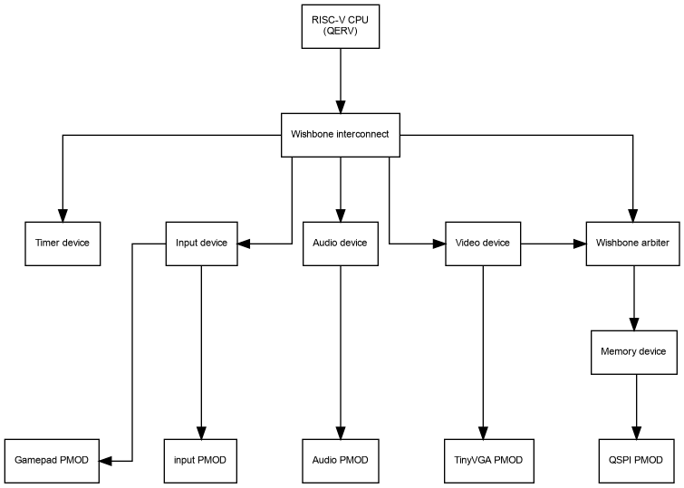

## How it works

As small-as-possible RISC-V SoC with video, audio and input - originally targeting running id Softwares DOOM.

The goal was to create the smallest possible SoC which could actually run DOOM in some shape or form. Not the best
or the fastest. But the smallest.

The target application is [DOOM for Tiny Tapeout](https://github.com/peter-noerlund/tt-doom), but it is general purpose
RV32Ezicsr RISC-V SoC with 16MB storage, 8MB RAM and timer/audio/video/input, so it can runing anything that fits those constraits.

### Architecture

The overall architecture is a RISC-V CPU (The SERV CPU core running in 4-bit mode, aka. QERV) connected to wishbone bus
with a memory and devices for timer, audio, video and input.

#### CPU

The CPU core is Olof Kindgren's SERV RISC-V core running in 4-bit mode (aka. QERV).

SERV was primarily designed to be as small as possible, and to run on FPGAs. Consequently, the reference design uses SRAM blocks
on the FPGAs to store the register file. We don't have that luxury here and the register file is instead stored in shift registers.
So, to limit the area required, the SoC targets RV32E, thus limiting the number of registers to 16. Futhermore x3 (gp) is hardcoded
to `0x01000400` and x4 (tp) is hardcoded to `0x00000000`.

Futhermore, the shift registers are constantly spinning, as this saved up a lot of muxes, but the consequence of that is that the
register file can only initiate an operation every 8th cycle (This a few adjustments to the SERV core to make it work properly).

To support the timer, interrupts and CSR is enabled, but to save space `MTVEC` is hardcoded to `0x00000008` and `MSCRATCH` and `MTVAL` is
hardcoded to `0x00000000`.

Usually, this would make handling interrupts problematic as `mscratch` is used to back up a register before it is used to save the
remaining registers in memory (So interrupts does not interfere with the interrupted software). But as `gp` is hardcoded to `0x01000400`,
the first 2KB of RAM can accessed without having to overwrite registers and it can thus be used to back up registers in interrupts.

The SERV CPU is by design very simple, so it does not try to prefetch anything from the bus. So every instruction is at least a memory fetch
(52 cycles) followed by an ALU operation (8 cycles). Some instructions may need an additional ALU operation or memory operation which will
add to the instruction time.

Instruction timings:

| Cycles | Instructions                                                                                             |
|-------:|----------------------------------------------------------------------------------------------------------|
|     64 | `LUI`, `AUIPC`, `ADDI`, `XORI`, `ORI`, `ANDI`, `SUB`, `XOR`, `OR`, `AND`                                 |
|     72 | `JAL`, `JALR`, `BEQ`, `BNE`, `BLT`, `BGE`, `BLTU`, `BGEU`, `SLTI`, `SLTIU`, `SLLI`, `SLL`, `SLT`, `SLTU` |
|     80 | `SRLI`, `SRAI`, `SRL`, `SRA`                                                                             |
|    104 | `SB`                                                                                                     |
|    112 | `SH`                                                                                                     |
|    128 | `LB`, `LH`, `LW`, `LBU`, `LHU`, `SW`                                                                     |

Note that if the video device is using the memory bus, the CPU clocks and an instruction will take longer.

#### Timer device

The timer device is a simple counter which counts down every cycle. When it reaches zero, the timer interrupt is triggered.

The timer is 19 bits long, so at 65MHz, the slowest the timer can run is 124Hz. DOOM originally used a 140Hz timer to update the audio,
so that was the basis for the timer size.

The timer memory space is as follows:

| Address      | Size    | Mode       | Description                         |
|--------------|---------|------------|-------------------------------------|
| `0x02000000` | 4 bytes | Write-only | Counter value. 0 disables the timer |

To get the interrupt from the timer, interrupts has be be enabled in the `mstatus` CSR register and timer interrupts has to be enabled in the `mie` CSR register.

#### Input device

The input device support both the gamepad PMOD and simple raw input pins.

| Address      | Mode    | Mode      | Description |
|--------------|---------|-----------|-------------|
| `0x02000004` | 4 bytes | Read-only | Input data  |

The input data:

| Bits      | Description           |
|-----------|-----------------------|
| `[11:0]`  | State of gamepad #1   |
| `[23:12]` | State of gamepad #2   |
| `[31:24]` | State of `ui_in[7:0]` |

See the documentation for the gamepad PMOD to see the exact bit layout.

#### Audio device

The audio device is designed to minic how the PC speaker was used with software back in the 90'ies. Much like the timer, the audio device is simply a timer counting down.
When the timer reaches zero, the audio output pin is inverted and the counter is reset to the value saved by the application. It continues counting down, flipping and resetting
as long as the stored reset value is not zero.

The underlying counter is 18-bit, allowing frequencies as low as 124 Hz.

| Address      | Size    | Mode       | Description |
|--------------|---------|------------|-------------|
| `0x02000008` | 4 bytes | Write-only | Reset value |

Note the two least significant bits of the reset values are hardcoded to 0.

#### Video device

The video device uses the TinyVGA PMOD and renders a 128x96 frame on an 1024x768 @ 60Hz display, repeating every pixel and line 8 times. Internally it only stores a single scan line and fetches the next
line memory when needed.

To balance the need for color fidelity, resolution and memory area, the scan line is compressed using Color Cell Compression, much akin to S3TC/DXT1/ASTC, etc. Each line is represented as
16 chunks of 32 bits (28 bits internally):

| Bits      | Description                 |
|-----------|-----------------------------|
| `[1:0]`   | Color selection for pixel 0 |
| `[3:2]`   | Color selection for pixel 1 |
| `[5:4]`   | Color selection for pixel 2 |
| `[7:6]`   | Color selection for pixel 3 |
| `[9:8]`   | Color selection for pixel 4 |
| `[11:10]` | Color selection for pixel 5 |
| `[13:12]` | Color selection for pixel 6 |
| `[15:14]` | Color selection for pixel 7 |
| `[17:16]` | Blue component of color 1   |
| `[19:18]` | Green component of color 1  |
| `[21:20]` | Red component of color 1    |
| `[23:22]` | _Unused_                    |
| `[25:24]` | Blue component of color 2   |
| `[27:26]` | Green component of color 2  |
| `[29:28]` | Red component of color 2    |
| `[31:30]` | _Unused_                    |

Color selection:

| Value | Description              |
|-------|--------------------------|
| `00`  | Black                    |
| `01`  | Color 1                  |
| `10`  | Color 2                  |
| `11`  | Average of color 1 and 2 |

#### Memory device

The memory device uses the Tiny Tapout QSPI PMOD consiting both of a Flash and two PSRAM chips. To make room for the
audio PMOD, only one of the two PSRAM chips are used, so that gives you 16 MiB flash and 8 MiB PSRAM.

Both flash and PSRAM are driven with QSPI in a 1-4-4 mode, so instructions are serial while address and data is quad.

The memory device supports linear bursts over the Wishbone bus, which is used by the video device to fetch the video
line quickly. The CPU does not burst, however.

The latency from reading 32 bits from either flash or PSRAM is 56 cycles.

When bursting, each additional 32 bits takes 8 cycles.